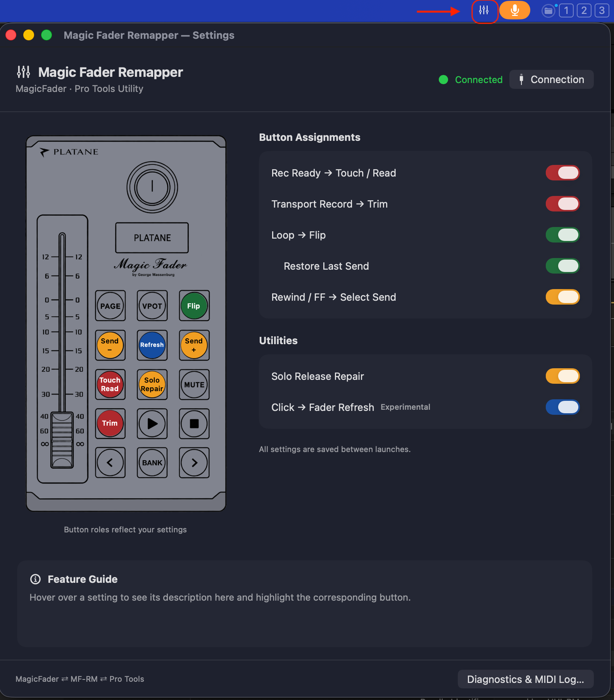

# Magic Fader Remapper (MF-RM)

日本語 · [English](README.md)

**PLATANE Magic FaderをPro Toolsで使うためのmacOSメニューバーユーティリティ**です。一部のHUI MIDIメッセージを変換し、ミックスでよく使うオートメーションやセンド操作を本体のボタンに割り当てます。ファームウェアやPro Tools本体は改造しません。



```text
Magic Fader ⇄ MF-RM ⇄ Pro Tools
```

GAKKEY LABによる独立したプロジェクトで、PLATANE・Avidの公式アプリではありません。本プロジェクトでの製品画像・ロゴの使用についてはPLATANEから許可をいただいています。[画像と商標について](THIRD_PARTY_NOTICES.md)もご確認ください。

## ダウンロード・動作環境

- [macOS版 2026.10.3をダウンロード](https://github.com/gakkeygakkey/gakkey-lab-site/releases/download/MF-RM-2026.10.3/Magic-Fader-Remapper-2026.10.3.dmg) · [配布ページ](https://github.com/gakkeygakkey/gakkey-lab-site/releases/tag/MF-RM-2026.10.3)
- **macOS 15.6以降**。配布アプリはAppleシリコン／Intel Mac対応のユニバーサルバイナリです。
- HUIモードのMagic Faderと、HUI接続に対応するPro Tools。TrimはPro Tools側にもTrimオートメーション機能が必要です。
- 日本語・英語の画面に対応しています。

既存のDMGは現在、GAKKEY LABのWebサイト用リポジトリで配布しています。このリポジトリはアプリのソースコードです。古いmacOSへの対応は未検証です。

## 機能

初回起動時は**すべてのスイッチがOFF**です。必要な機能をONにしてください。各設定と、最後に接続できたコントローラーの入出力を記憶します。

| 設定 | 動作 |
| --- | --- |
| Rec Ready → Touch / Read | トラックの録音待機ボタンでTouchとReadを切り替えます。ランプはオートメーションのフィードバックに追従します。 |
| 録音 → Trim | トランスポートの録音ボタンでTrimを切り替え、ランプにも反映します。 |
| ループ → Flip | HUIのFlipで、センド音量をモーターフェーダーで操作します。Flip中はループランプが点灯。解除後はPanを選び直して、通常の表示とフェーダー操作へ戻します。 |
| 前回のセンドを復元 | Flipに入る時、前回選んだセンドを復元します。記憶がない場合はSend Aを使います。 |
| 巻戻し／早送り → センド切替 | Flip状態に関係なく、前／次のセンドへ切り替えます。A〜Eを循環し、停止ボタンは通常どおりです。 |
| Solo Release補完 | SoloのPressから約50ms後に、不足するReleaseを補います。制限は後述します。 |
| メトロノーム → リフレッシュ（試験機能） | フェーダー位置の範囲に対して約5%動かし、約100ms後に元へ戻します。モーターが唸り続ける時の対処です。 |

項目にポインターを合わせると説明と対応ボタンを表示します。本体図の色は**設定上の割り当て**を示し、実機ランプの現在状態ではありません。「診断・MIDIログ」では通信の記録・コピー・消去ができます。記録OFFでも中継は続きます。

## 接続方法

1. DMGを開き、**MF-RM**を**Applications**フォルダにドラッグして起動します。
2. **メニューバーのフェーダーマーク**から「設定…」を開きます。
3. Magic FaderをHUIモードにします。「接続設定」で入力・出力ともにMagic Faderを選び、「接続」を押します。
4. Pro Toolsの **MIDI Input Devices** で **MF-RM** を有効にします。初回はチェックが外れており、HUIの受信元リストに表示されない場合があります。
5. **Peripherals → MIDI Controllers** で、タイプを **HUI**、Receive From／Send Toを両方 **MF-RM**、チャンネル数を **8** に設定します。同じMagic Faderへの直接HUI接続を重複して設定しないでください。
6. MF-RMで使いたい機能をONにします。この接続経路を使う間はアプリを起動しておいてください。

保存したMIDI入出力が戻ると自動再接続します。機器の識別情報が変わった場合は、選択して接続し直してください。アプリを終了すると仮想MIDIポートもなくなります。MF-RMなしで使用する場合は、Pro Tools側を本体への直接接続に戻してください。

## 動作と制限

### Solo Release補完

Magic Faderのファームウェア **2.11** で、SoloのPressに対応するReleaseが送られていないことを確認しました。Pro ToolsのSolo Modeが **X-OR** の場合、本体のSolo操作後に **Shift＋SでSoloを解除できなくなる**症状が発生しました。**Momentary** では離してもSoloが残りました。Latchでは、報告したShift＋Sの問題は発生しませんでした。

作者の環境では、補完でX-ORの問題が解消しています。ただし約50ms後にReleaseを生成する方式なので、**実際にボタンを離したタイミングは検出しません**。Momentaryの「押している間だけSolo」を再現するものではありません。

PLATANEからは2026年10月に、Release欠落を確認し修正版ファームウェアを開発中との連絡をいただきました。これは当時の報告で、最新ファームウェアの状態を示すものではありません。Releaseが正しく送られるファームウェアでは補完をOFFにし、X-OR・Momentaryを直接確認してください。Muteや未検証のボタンへ一律にReleaseを追加する処理は行いません。

### フェーダーリフレッシュ

再生停止中に、フェーダーから手を離して使用してください。移動・復帰指示は **Magic Fader本体だけ**に送り、Pro Toolsには送りません。通常の双方向MIDI通信は継続しており、通信を遮断する機能ではありません。タッチやPro Toolsからの新しいフェーダー位置を検出した時は中止し、通常操作を優先します。

対象は最後に選択したHUIチャンネルです。バンク外のトラックが選ばれても本体の操作対象を維持するMagic Faderの動作に合わせています。事前に対象の位置情報を受信している必要があります。作者の実使用ではPro Tools側の値を変えずに唸りを軽減できていますが、機械的な不具合や電源問題を修理する機能ではなく、試験的な対処です。

### Flipと中継

- センド切替の対象は **A〜E**。F〜Jの選択は実装していません。
- HUIのFlipではMuteやV-Potの割り当ても変化します。オートメーションを書き込む前に対象センドを確認してください。
- スイッチをOFFにするとボタンの役割は戻りますが、変更済みのPro ToolsのオートメーションやFlipの状態まで自動的に戻すとは限りません。
- HUIのPingに代理応答する機能はありません。実機を接続して使用してください。
- 「接続中」はコントローラーとの接続状態で、Pro ToolsのHUI通信成立を保証する表示ではありません。

## ソースからビルドする

プロジェクト・スキーム名は開発当初の **HUI-RM** のままです。出力は **MF-RM.app**、MIDIポート名は **MF-RM**。設定を引き継ぐためBundle Identifierは `com.gakkey.HUI-RM` を維持しています。

1. `HUI-RM.xcodeproj` をXcodeで開きます。ソース公開準備には **Xcode 27.1** を使用しています。古い開発環境は未検証です。Icon Composerの `.icon` アセットを含みます。
2. **HUI-RM** スキームと **My Mac** を選択します。署名付きでビルドする場合、Signing & Capabilitiesで自分の開発チームを選んでください。保存されているチームは作者のものです。
3. ビルドして起動します。共有スキームはXcodeからの起動言語に英語を指定しています。日本語やシステム言語を試す場合は Scheme → Run → Options → App Language を変更してください。

署名・起動を行わないコンパイル確認は、リポジトリのルートで実行します。

```sh
xcodebuild -project HUI-RM.xcodeproj -scheme HUI-RM -configuration Release -destination 'generic/platform=macOS' -derivedDataPath /tmp/MFRM-build CODE_SIGNING_ALLOWED=NO build
```

`Tests/` にメッセージ処理の単体チェックがあります。例：

```sh
xcrun swiftc -module-cache-path /tmp/MFRM-swift-cache HUI-RM/RecAutomationRemapper.swift HUI-RM/EventListTransport.swift Tests/EventListTransportChecks.swift -o /tmp/MFRM-transport-checks
/tmp/MFRM-transport-checks
```

これらは実機とPro Toolsでの操作確認の代わりにはなりません。[過去の開発記録](docs/development-history.md)には、現在と異なる途中段階の仕様も含まれます。

## フィードバック・開発への参加

作者自身のミックス作業のために作り、ほかのMagic Faderユーザーにも使用していただいています。不具合報告や改善提案を歓迎しますが、すべての機器・Pro Tools・macOSの組み合わせを保証するものではありません。

報告時はmacOS・Pro Tools・ファームウェアのバージョン、有効な設定、操作手順、必要に応じて短いMIDIログを添えてください。Soloの問題では **Latch／X-OR／Momentary** も明記してください。公開前に、ログや画像にセッション名・トラック名が含まれていないか確認してください。

## ライセンス

独自のソースコードと文書は [MIT License](LICENSE) で公開します。**製品画像・ロゴ・商標は対象外**です。[THIRD_PARTY_NOTICES.md](THIRD_PARTY_NOTICES.md)を参照してください。本プロジェクトへの使用許可は、他の製品へのPLATANEブランドの自由な転用を認めるものではありません。
